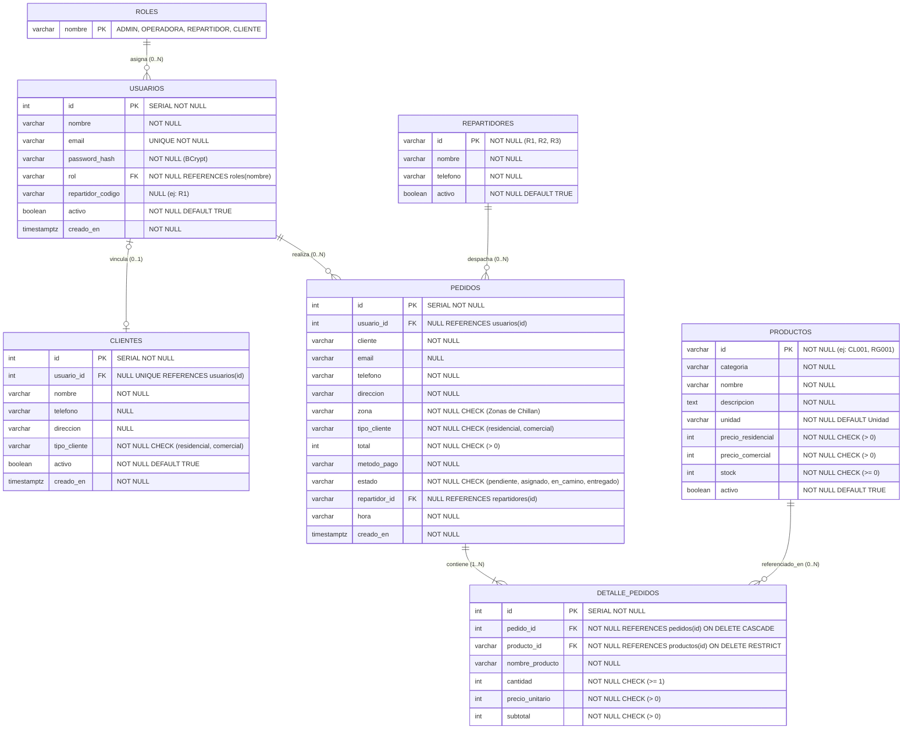
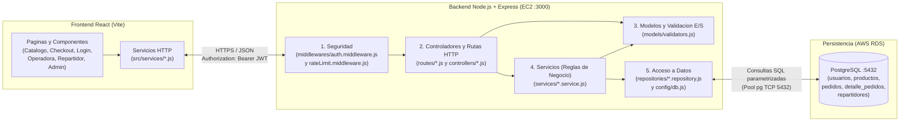
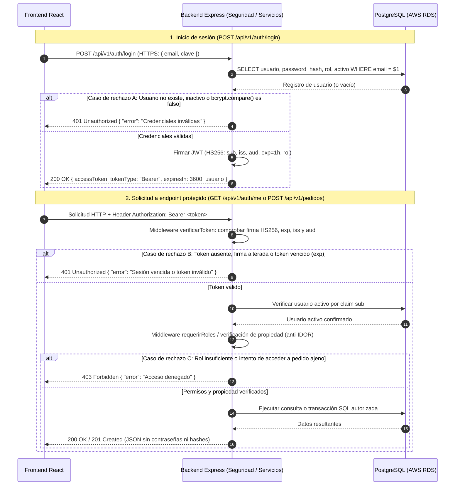

# Distribuidora de Gas El Volcán · Backend API REST

Proyecto semestral con fines académicos para la asignatura **DSY1104 · Desarrollo Fullstack II (Unidad 3 · 2026)**.

## Integrantes del equipo

- **Benjamin Gutierrez**
- **Nicolas Ibañez**
- **Joel Espinoza**

## Caso de negocio y continuidad del proyecto

**Distribuidora de Gas El Volcán** es una empresa familiar de Chillán dedicada a la venta y despacho de cilindros de gas licuado (GLP de 5, 11, 15 y 45 kg), reguladores, mangueras y accesorios de seguridad para clientes **residenciales** y **comerciales**. Con una flota de reparto y atención telefónica/web, gestiona entre 80 y 120 pedidos diarios divididos en zonas de despacho (*Zona Centro, Zona Oriente, Zona Rural, Zona Sur y Zona Comercial*).

Este repositorio contiene exclusivamente el **backend API REST**, la capa de persistencia en **PostgreSQL (Amazon RDS)**, la seguridad con **BCrypt + JWT** y la documentación interactiva **OpenAPI / Swagger UI**, dando continuidad al ERS y al frontend React desarrollado en la Unidad 2.

- **Repositorio del Frontend (React + Vite):** [Distribuidora-Gas-El-Volcan-React](https://github.com/joelespinoza-beg/Distribuidora-Gas-El-Volcan-React)
- **Especificación de Requisitos (ERS v1):** [Carpeta ERS en Google Drive](https://drive.google.com/drive/folders/1gQgQNAdRC82WPKbCPvOgrOTeHvAdklCW?usp=drive_link)

---

## Estado actual de avance del proyecto

| Componente / Funcionalidad | Estado | Detalle de verificación |
|---|---|---|
| **Repositorio y estructura por capas (`src/`)** | **Implementado y probado** | Separación en `routes`, `controllers`, `services`, `repositories`, `middlewares`, `models` y `config`. |
| **Esquema SQL y datos semilla (`sql/schema_and_seed.sql`)** | **Implementado; migración pendiente de ejecutar en RDS** | Tablas `usuarios`, `roles`, `clientes`, `repartidores`, `productos`, `pedidos` y `detalle_pedidos` con PK, FK y restricciones `CHECK`/`UNIQUE`. |
| **Conexión a PostgreSQL (`pg.Pool`) + modo local** | **Implementado y probado** | Configuración lista para Amazon RDS mediante variables de entorno (`.env`) y respaldo en memoria para pruebas automatizadas. |
| **Autenticación JWT y hash BCrypt (`/api/v1/auth/*`)** | **Implementado y probado** | `POST /api/v1/auth/register`, `POST /api/v1/auth/login` y `GET /api/v1/auth/me` con firma `HS256`, validación de `iss`/`aud`/`exp` y rate limit. |
| **CRUD de usuarios y roles (`/api/v1/usuarios`)** | **Implementado y probado** | Rutas protegidas por JWT y rol, propiedad de cuenta o administración, cuatro roles persistidos y desactivación que conserva los pedidos. |
| **CRUD de clientes (`/api/v1/clientes`)** | **Implementado y probado** | Perfiles vinculados opcionalmente a cuentas, acceso propio o administrativo y datos de pedido independientes del perfil. |
| **CRUD de Catálogo de Productos (`/api/v1/productos/*`)** | **Implementado y probado** | Lectura pública y creación/edición/eliminación restringida a rol `ADMIN`, con validación de integridad referencial (`409`). |
| **Flujo de Pedidos y Despacho (`/api/v1/pedidos/*`)** | **Implementado y probado** | Cálculo de precios en servidor según `tipoCliente`, descuento atómico de stock, asignación de repartidor, cambio de estado y protección anti-IDOR. |
| **Documentación viva Swagger UI (`/api-docs`)** | **Implementada y probada** | Especificación OpenAPI 3.0.3 interactiva con rutas canónicas `/api/v1`, esquema `BearerAuth` y ejemplos del negocio. |
| **Suite de pruebas automatizadas (`tests/api.test.js`)** | **Implementada y aprobada** | Casos de usuarios, clientes, roles, rutas privadas, rutas v1 y reglas de negocio ejecutados con `npm test`. |
| **Consumo desde el repositorio Frontend React** | **Pendiente (fuera de este cambio backend)** | Axios/fetch, persistencia de sesión tras recarga y restricciones de interfaz; lista de trabajo en `docs/FRONTEND_INTEGRATION.md`. |

### Alcance del Desarrollador 1 y versionado

La base de datos mantiene `usuarios`, `roles` y `clientes` separados. Los roles del caso son `ADMIN`, `OPERADORA`, `REPARTIDOR` y `CLIENTE`; el registro público siempre asigna `CLIENTE`. Las operaciones administrativas de usuario y cliente requieren JWT y rol `ADMIN`, mientras que un cliente solo puede consultar o modificar su perfil propio.

Las rutas canónicas de la API usan el prefijo `/api/v1`. Para facilitar la transición del resto del equipo, el prefijo anterior `/api` se conserva como alias temporal con los mismos permisos; se debe usar `/api/v1` en nuevos consumidores. Swagger documenta las rutas canónicas versionadas.

El recordatorio de trabajo pendiente en React está en [`docs/FRONTEND_INTEGRATION.md`](./docs/FRONTEND_INTEGRATION.md). La integración de Axios, persistencia de sesión, formularios y restricciones visuales queda pendiente en el repositorio frontend.

Rutas de usuarios y clientes: `GET/POST /api/v1/usuarios`, `GET/PATCH/DELETE /api/v1/usuarios/:id`, `GET /api/v1/usuarios/roles`, `PATCH /api/v1/usuarios/:id/rol`, `GET/POST /api/v1/clientes`, `GET/PATCH/DELETE /api/v1/clientes/:id` y `GET/PATCH /api/v1/clientes/me`. `DELETE /api/v1/usuarios/:id` desactiva la cuenta; no elimina pedidos ni su historial. Swagger está disponible en `/api-docs`.

---

## 1. Paso 1: Elección de la solución backend

### 1.1. Tecnología (Lenguaje y Framework) vs. Infraestructura de ejecución

| Dimensión | Elección del equipo | Justificación técnica y de negocio |
|---|---|---|
| **Lenguaje y Framework de Backend** | **Node.js (v22 LTS) + Express 4** | Permite unificar el lenguaje JavaScript en todo el stack (React en frontend y Node.js en backend), reutilizando las reglas de validación de dominio y facilitando el mantenimiento por todos los integrantes del equipo. Express facilita una arquitectura modular clara por capas (rutas, controladores, servicios, repositorios y middlewares). |
| **Infraestructura de ejecución** | **Instancia Amazon EC2 (Ubuntu LTS)** | EC2 y AWS Lambda son alternativas de infraestructura donde se ejecuta el código, no frameworks de backend. Elegimos **EC2** porque un servidor Express persistente mantiene vivo el `Pool` de conexiones TCP hacia PostgreSQL (evitando agotar conexiones o requerir RDS Proxy ante ráfagas de solicitudes), expone de manera continua la interfaz interactiva de **Swagger UI (`/api-docs`)** y evita latencias de arranque en frío (*cold starts*) durante las horas punta de pedidos de gas en Chillán. |
| **Motor de Base de Datos** | **PostgreSQL en Amazon RDS** | Motor relacional robusto que garantiza integridad transaccional (`BEGIN / COMMIT / ROLLBACK`) al descontar stock de cilindros y registrar líneas de pedido simultáneamente. Se despliega en Amazon RDS con `Public access: No` en el puerto `5432`, accesible únicamente desde el grupo de seguridad autorizado del backend en EC2 dentro de la misma VPC. |

### 1.2. Ejecución y operación de Node.js en EC2

1. **Inicio del servidor:** El punto de entrada `server.js` inicializa la conexión con la base de datos y levanta el servidor HTTP Express escuchando en `0.0.0.0` y en el puerto `3000` (configurable mediante la variable de entorno `PORT`).
2. **Mantenimiento del proceso activo:** En sesiones de laboratorio y pruebas se inicia con `npm start`. Para operación continua en EC2 sin depender de una terminal SSH abierta, el proceso se mantiene activo mediante un gestor de procesos como **PM2** (`pm2 start server.js --name elvolcan-api`) o un servicio de **`systemd`**, reiniciándose automáticamente ante caídas.
3. **Recepción de solicitudes:** El Grupo de Seguridad (*Security Group*) de la instancia EC2 autoriza tráfico de entrada TCP en el puerto `3000` para clientes autorizados (y puerto `22` restringido a la IP de administración por SSH), mientras que el grupo de seguridad de RDS solo acepta tráfico TCP `5432` proveniente del grupo de seguridad de EC2.

### 1.3. Componentes y bibliotecas utilizadas

| Categoría | Biblioteca / Herramienta | Función dentro del backend |
|---|---|---|
| **API REST y CORS** | `express` (`^4.21.2`) y `cors` (`^2.8.5`) | Enrutamiento HTTP, parseo de JSON (`express.json()`), manejo centralizado de estados/errores HTTP y control de orígenes permitidos del frontend. |
| **Acceso a datos** | `pg` (`^8.13.3`) | Cliente oficial de PostgreSQL para Node.js. Gestiona el `Pool` de conexiones hacia Amazon RDS y ejecuta consultas SQL parametrizadas (`$1, $2...`) que previenen inyección SQL. |
| **Validación** | Módulo propio `src/models/validators.js` | Valida y sanitiza en el servidor los contratos de entrada (correo, teléfono chileno de 8 a 15 dígitos, zonas de Chillán, tipos de cliente, precios enteros positivos y stock no negativo). |
| **Contraseñas** | `bcryptjs` (`^2.4.3`) | Generación y verificación de hashes adaptativos BCrypt con sal aleatoria incorporada (`cost = 10`). |
| **Autenticación JWT** | `jsonwebtoken` (`^9.0.2`) | Firma y verificación criptográfica de tokens JWT con algoritmo `HS256` y validación estricta de claims (`sub`, `iss`, `aud`, `exp`). |
| **Documentación viva** | `swagger-ui-express` (`^5.0.1`) | Publica la especificación OpenAPI 3.0.3 y sirve la interfaz interactiva Swagger UI en `/api-docs`. |
| **Pruebas** | `node:test` + `supertest` (`^7.0.0`) | Ejecución de pruebas automatizadas de integración sobre todos los endpoints HTTP y reglas de negocio sin requerir herramientas externas para correr `npm test`. |

---

## 2. Paso 2: Relación entre el Frontend React y el Backend

### 2.1. Transición desde `src/services/` del Frontend hacia la API REST

En la Unidad 2, el frontend React (`Distribuidora-Gas-El-Volcan-React`) almacenaba datos simulados en `localStorage`. En esta etapa, la persistencia y las reglas críticas pasan al servidor:

| Servicio en React (`src/services/`) | Pantallas que lo utilizan | Endpoints del Backend que reemplazan a `localStorage` | Qué cambia en la responsabilidad |
|---|---|---|---|
| `productoService.js` (`listarProductos`, `obtenerProducto`, `crearProducto`, `actualizarProducto`, `eliminarProducto`) | `Inicio.jsx`, `Catalogo.jsx`, `Categorias.jsx`, `Ofertas.jsx`, `Producto.jsx`, `NuevoPedido.jsx`, `AdminProductos.jsx` | `GET /api/v1/productos`<br>`GET /api/v1/productos/:id`<br>`POST /api/v1/productos`<br>`PUT /api/v1/productos/:id`<br>`DELETE /api/v1/productos/:id` | El catálogo deja de inicializarse en `localStorage` desde `src/data/productos.js` y se consulta desde PostgreSQL. Las mutaciones exigen JWT con rol `ADMIN`. |
| `pedidoService.js` (`listarPedidos`, `obtenerPedido`, `crearPedido`, `asignarRepartidor`, `cambiarEstado`) | `Checkout.jsx`, `PedidoConfirmadoONoRealizado.jsx`, `SeguimientoPedido.jsx`, `Operadora.jsx`, `Repartidor.jsx` | `GET /api/v1/pedidos`<br>`GET /api/v1/pedidos/:id`<br>`POST /api/v1/pedidos`<br>`PATCH /api/v1/pedidos/:id/asignar`<br>`PATCH /api/v1/pedidos/:id/estado` | El servidor calcula `precioUnitario` y `total` reales según `tipoCliente`, descuenta el `stock` en la base de datos y filtra los pedidos según el rol y la propiedad del usuario autenticado. |
| `usuarioService.js` (`registrarUsuario`, `autenticar`, `listarUsuarios`) | `Registro.jsx`, `Login.jsx`, `Navbar.jsx` | `POST /api/v1/auth/register`<br>`POST /api/v1/auth/login`<br>`GET /api/v1/auth/me` | Se elimina por completo el guardado de claves en texto plano en `localStorage`. El servidor almacena solo el hash BCrypt y emite un token JWT firmado. |
| `carritoService.js` (`listarCarrito`, `agregarAlCarrito`, `cambiarCantidadCarrito`, `quitarDelCarrito`, `vaciarCarrito`) | `Carrito.jsx`, `Catalogo.jsx`, `Checkout.jsx` | Permanece en el navegador hasta confirmar en `POST /api/v1/pedidos` | El carrito sigue siendo un estado temporal de la solicitud en curso en el cliente, pero al enviarse en `/checkout` el backend revalida existencia, stock disponible y precios oficiales. |

### 2.2. Comportamiento de la interfaz React ante los estados de la API

| Estado / Respuesta de la API | Comportamiento definido en la interfaz React |
|---|---|
| **Carga (`loading`)** | Mientras la promesa `fetch` está en curso, los botones de envío (`Ingresar`, `Confirmar pedido`, `Guardar`) se deshabilitan (`disabled={cargando}`) y se muestra un indicador con `role="status"` (`"Cargando datos..."`). |
| **Éxito (`200 OK` / `201 Created` / `204 No Content`)** | Se actualiza el estado del Context correspondiente (`ProductosContext`, `PedidosContext`, `AuthContext`), se muestra alerta Bootstrap `alert-success` (`role="status"`) o se navega a la pantalla de resultado (`/pedido/resultado/:id`). |
| **Datos vacíos (`200 OK` con `[]`)** | Se renderizan los mensajes de estado vacío ya contemplados en los organismos React: `"No hay pedidos registrados para hoy."` (`ListaPedidosDelDia`), `"No tienes entregas asignadas."` (`ListaEntregas`) o `"No encontramos productos"` (`Catalogo`). |
| **Errores de validación (`400 Bad Request`) o conflicto (`409 Conflict`)** | Las validaciones de React (`src/utils/validaciones.js`) ayudan al usuario antes de enviar, pero si el backend rechaza la solicitud (`400` con `detalles` por campo o `409` por stock insuficiente / correo duplicado), el formulario muestra el mensaje devuelto en `alert-danger` (`role="alert"`). |
| **Sesión vencida o no autenticada (`401 Unauthorized`)** | Si una petición protegida recibe `401`, el frontend limpia el token en memoria, cierra la sesión activa y redirige a `/login` con el aviso `"Tu sesión ha expirado. Ingresa nuevamente."`. |
| **Falta de permisos (`403 Forbidden`)** | Si un usuario intenta ejecutar una acción sin el rol requerido o consultar un pedido ajeno, la interfaz muestra una alerta `alert-warning` / `alert-danger` indicando `"No tienes permisos para realizar esta operación"` y bloquea la vista. |

### 2.3. Recorrido completo de una operación del caso: Confirmación de pedido en `/checkout`

1. **Pantalla / Formulario en React (`Checkout.jsx`):** El cliente autenticado revisa las líneas de su carrito (ej. `2 × Cilindro GLP 15 kg`, código `CL003`) y completa `nombre`, `email`, `telefono`, `direccion` y `zona` (*Zona Centro*). React ejecuta la validación preliminar (`validarObligatorio`, `validarEmail`, `validarTelefono`) para dar retroalimentación inmediata.
2. **Solicitud HTTP a la API:** El servicio `pedidoService.crearPedido()` envía `POST /api/v1/pedidos` con el encabezado `Authorization: Bearer <accessToken>` y el cuerpo JSON con los datos de despacho y la lista `productos: [{ "id": "CL003", "cantidad": 2 }]`.
3. **Capa de Seguridad (`auth.middleware.js`):** El middleware `verificarToken` comprueba la firma `HS256` del JWT, su vigencia (`exp`), emisor (`iss`) y destinatario (`aud`), verifica en la base de datos que el usuario siga activo y adjunta `req.usuario` (`id`, `rol`). Luego `requerirRoles` confirma que el rol esté autorizado.
4. **Controlador (`pedido.controller.js`):** Recibe `req.body` y `req.usuario`, delega la operación a `pedidoService.crearPedido(req.body, req.usuario)` y prepara la respuesta HTTP.
5. **Servicio y Reglas del Negocio (`pedido.service.js`):**
   - Valida nuevamente todos los campos de entrada con `validarEntradaPedido`.
   - Consulta el producto `CL003` en la base de datos. Si no existe, aborta con `404 Not Found`.
   - Comprueba que `stock >= 2`. Si el stock actual no alcanza, aborta con `409 Conflict` (*"Stock insuficiente para Cilindro GLP 15 kg"*).
   - **Calcula el precio en el servidor:** Ignora cualquier precio enviado por el navegador; toma de la base de datos `precio_residencial` ($16.000) o `precio_comercial` ($14.500) según `tipoCliente`, calcula `subtotal = 32000` y `total = 32000`, y fija `usuarioId = req.usuario.id`, `estado = 'pendiente'` y `repartidorId = null`.
6. **Acceso a Datos y Base de Datos (`pedido.repository.js` -> PostgreSQL RDS):** Abre una transacción SQL (`BEGIN`), inserta la cabecera en la tabla `pedidos`, inserta cada línea en `detalle_pedidos`, descuenta el stock en `productos` (`UPDATE productos SET stock = stock - 2 WHERE id = 'CL003'`) y confirma con `COMMIT`.
7. **Respuesta al usuario:** El backend devuelve `201 Created` con el objeto JSON del pedido creado (incluyendo el `id` generado y la `hora`). React vacía el carrito local y redirige a `/pedido/resultado/:id`.

---

## 3. Paso 3: Diseño de la Base de Datos y Protección de Contraseñas

### 3.1. Diagrama Entidad-Relación (ERD)

El modelo relacional utiliza los nombres reales del dominio de **Distribuidora de Gas El Volcán**:



### 3.2. Justificación de decisiones del modelo

1. **Separación entre `pedidos` y `detalle_pedidos`:** En el frontend de la Unidad 2, un pedido guardaba un arreglo JSON `productos` dentro de `localStorage`. En PostgreSQL se normalizó en dos tablas (`pedidos` como cabecera y `detalle_pedidos` con relación `1:N`) para garantizar integridad referencial con la tabla `productos`, permitir pedidos con múltiples cilindros/accesorios desde `/carrito` y conservar el `precio_unitario` histórico al momento de la compra aunque el catálogo cambie de precio en el futuro.
2. **Claves primarias de negocio en `productos` (`CL001..AC003`) y `repartidores` (`R1..R3`):** Se conservaron los códigos alfanuméricos definidos en el ERS y en las pruebas unitarias de Vitest del frontend para mantener compatibilidad directa entre las rutas de React (`/producto/CL001`) y la base de datos.
3. **Precios diferenciados en `productos`:** Cada producto almacena tanto `precio_residencial` como `precio_comercial`, permitiendo que el servidor determine el precio aplicable sin depender de cálculos del navegador.

### 3.3. Reglas de integridad y eliminación de registros relacionados

- **Datos que no pueden duplicarse (`UNIQUE` / `PRIMARY KEY`):**
  - `usuarios.email`: Único sin distinguir mayúsculas/minúsculas (normalizado a minúsculas antes de insertar; devuelve `409 Conflict` ante intento de duplicado).
  - `productos.id`: Código único de catálogo (`CL001`, `RG001`, etc.; devuelve `409 Conflict` si el administrador intenta repetir un código).
  - `repartidores.id`: Identificador único de repartidor (`R1`, `R2`, `R3`).
- **Cantidades, montos y dominios válidos (`CHECK`):**
  - `precio_residencial > 0`, `precio_comercial > 0`, `precio_unitario > 0`, `subtotal > 0` y `total > 0`.
  - `productos.stock >= 0` (el stock nunca puede quedar negativo) y `detalle_pedidos.cantidad >= 1`.
  - `usuarios.rol` referencia a `roles.nombre`; el catálogo persiste `ADMIN`, `OPERADORA`, `REPARTIDOR` y `CLIENTE`.
  - `pedidos.estado IN ('pendiente', 'asignado', 'en_camino', 'entregado')`.
- **Relaciones obligatorias y comportamiento al eliminar registros relacionados:**
  - `detalle_pedidos.producto_id -> productos(id) ON DELETE RESTRICT`: **No se permite eliminar un producto que ya figura en pedidos históricos.** El servicio verifica esta condición y devuelve `409 Conflict` para no destruir la trazabilidad de ventas pasadas.
  - `detalle_pedidos.pedido_id -> pedidos(id) ON DELETE CASCADE`: Toda línea de detalle existe únicamente dentro de su pedido padre.
  - `pedidos.repartidor_id -> repartidores(id) ON DELETE SET NULL` y `pedidos.usuario_id -> usuarios(id) ON DELETE SET NULL`: Conserva el registro histórico del pedido aunque se dé de baja una cuenta.

### 3.4. Paso de datos simulados a datos iniciales de prueba (Seeders)

El esquema (`sql/schema_and_seed.sql`) crea de forma idempotente los cuatro roles. En modo memoria se mantienen cuentas de demostración para pruebas; **no se crean usuarios/contraseñas de demostración en PostgreSQL/RDS**. Para una instalación PostgreSQL, configura `BOOTSTRAP_ADMIN_EMAIL` y `BOOTSTRAP_ADMIN_PASSWORD` para crear el primer administrador; los usuarios operativos restantes se gestionan autenticado como `ADMIN`. El catálogo y los repartidores conservan sus datos iniciales mediante el seeder existente.

- **Qué persiste tras reiniciar el backend:** Conectado a **PostgreSQL en Amazon RDS**, toda la información (nuevos usuarios registrados, pedidos creados, cambios de estado de reparto, asignaciones y descuentos de stock en el catálogo) persiste de manera permanente en el almacenamiento de RDS aunque el proceso Node.js o la instancia EC2 se reinicien.

### 3.5. Protección de contraseñas mediante Hash (BCrypt)

- **Algoritmo elegido:** **BCrypt** (basado en el cifrado por bloques *Blowfish*, diseñado específicamente para hashing de contraseñas por Niels Provos y David Mazières).
- **Por qué es apropiado para contraseñas:** A diferencia de funciones hash rápidas de propósito general (como `MD5` o `SHA-256`, diseñadas para máxima velocidad y vulnerables a ataques de fuerza bruta con GPU), **BCrypt es deliberadamente lento y adaptativo**. Incorpora automáticamente una **sal criptográfica aleatoria de 128 bits (16 bytes)** por cada contraseña dentro del propio hash resultante (formato `$2a$10$<22-chars-salt><31-chars-hash>`), lo que impide por completo el uso de *rainbow tables* y garantiza que dos usuarios con la misma contraseña tengan hashes completamente distintos en la tabla `usuarios`.
- **Biblioteca y configuración aplicada:** Se utiliza `bcryptjs` (`^2.4.3`) con un factor de costo (**work factor / `saltRounds` = `10`**, equivalente a $2^{10} = 1.024$ rondas de expansión de clave), configurable mediante la variable de entorno `BCRYPT_SALT_ROUNDS`. Este valor ofrece un equilibrio óptimo recomendado por OWASP entre resistencia criptográfica y tiempo de respuesta (~65–90 ms por verificación en EC2).
- **Fuentes consultadas:**
  1. *OWASP Cheat Sheet Series — Password Storage Cheat Sheet:* https://cheatsheetseries.owasp.org/cheatsheets/Password_Storage_Cheat_Sheet.html
  2. *Provos, N., & Mazières, D. (1999). A Future-Adaptable Password Scheme (USENIX Annual Technical Conference):* https://www.usenix.org/legacy/events/usenix99/provos/provos.pdf
  3. *Documentación oficial del paquete `bcryptjs`:* https://www.npmjs.com/package/bcryptjs

---

## 4. Paso 4: Organización de las responsabilidades del Backend

### 4.1. Esquema de arquitectura del sistema



### 4.2. Detalle de responsabilidades internas del Backend

| Responsabilidad | Archivos en este repositorio | Qué hace en nuestra solución |
|---|---|---|
| **Controladores y rutas HTTP** | `src/routes/*.routes.js`<br>`src/controllers/*.controller.js` | Reciben la solicitud Express (`req`), extraen parámetros de ruta/consulta/cuerpo, invocan a la capa de servicios y devuelven la respuesta JSON con el código de estado HTTP correspondiente (`200`, `201`, `204`, `400`, `401`, `403`, `404`, `409`). |
| **Servicios (Reglas del negocio)** | `src/services/auth.service.js`<br>`src/services/producto.service.js`<br>`src/services/pedido.service.js` | Aplican las reglas propias de *Distribuidora de Gas El Volcán*: cálculo del precio residencial o comercial en el servidor, verificación y descuento de stock, unicidad de códigos/correos, asignación de rol `CLIENTE` al registrarse y control de propiedad de pedidos. |
| **Acceso a datos** | `src/repositories/*.repository.js`<br>`src/config/db.js` | Ejecutan las consultas SQL parametrizadas (`SELECT`, `INSERT`, `UPDATE`, `DELETE`) y transacciones (`BEGIN / COMMIT / ROLLBACK`) sobre PostgreSQL mediante `pg.Pool`, aislando a los servicios del motor SQL. |
| **Modelos y datos de entrada/salida** | `src/models/validators.js`<br>`sql/schema_and_seed.sql` | Definen la estructura persistente de las entidades, validan los campos recibidos en la API y filtran los objetos de salida (`sanitizarUsuarioSalida`) para que jamás se expongan `password_hash` ni datos internos. |
| **Seguridad** | `src/middlewares/auth.middleware.js`<br>`src/middlewares/rateLimit.middleware.js` | Comprueban credenciales con BCrypt, emiten y verifican tokens JWT (`HS256`, `iss`, `aud`, `exp`), controlan el límite de intentos de login y verifican los permisos por rol antes de ejecutar acciones protegidas. |

### 4.3. Asignación de validaciones y cálculo de campos en el servidor (`POST /api/v1/pedidos`)

El frontend **no decide por sí solo el precio final, el rol del usuario ni la propiedad de un registro**:

| Campo de la operación | ¿Lo envía el cliente o lo calcula/asigna el servidor? | Responsabilidad del Backend que lo valida o calcula |
|---|---|---|
| `Authorization: Bearer <token>` | Enviado por el cliente en el header HTTP | **Seguridad (`auth.middleware.js`)**: verifica firma, vigencia, emisor y obtiene la identidad real (`req.usuario.id` y `req.usuario.rol`). |
| `cliente`, `telefono`, `direccion`, `zona`, `tipoCliente` | Enviados por el cliente en el body JSON | **Modelos (`validators.js`)**: valida presencia, formato de teléfono (8–15 dígitos), zona válida de Chillán y `tipoCliente` (`residencial` o `comercial`). |
| `productos: [{ id, cantidad }]` | Enviado por el cliente (código y cantidad) | **Modelos (`validators.js`)** valida `cantidad >= 1`; **Servicios (`pedido.service.js`)** verifica en BD que cada producto exista (`404`) y tenga `stock >= cantidad` (`409`). |
| `precioUnitario`, `subtotal` y `total` | **Calculados exclusivamente por el servidor** | **Servicios (`pedido.service.js`)**: ignora cualquier precio enviado por React; consulta `precio_residencial` o `precio_comercial` en la tabla `productos` y multiplica por la cantidad. |
| `usuarioId` (propietario del pedido) | **Asignado exclusivamente por el servidor** | **Servicios (`pedido.service.js`)**: toma `req.usuario.id` directamente del token JWT validado. |
| `id`, `estado`, `repartidorId`, `hora` | **Generados exclusivamente por el servidor** | **Servicios y Acceso a Datos**: `id` secuencial (`SERIAL`), `estado = 'pendiente'`, `repartidorId = null` y `hora` del servidor. |

---

## 5. Paso 5: Contratos de los Endpoints y Documentación Swagger / OpenAPI

### 5.1. Mapa general de endpoints y relación con pantallas y entidades

| Método y Ruta | Estado actual | Permisos / Roles | Pantalla React que lo consume | Entidades involucradas |
|---|---|---|---|---|
| `GET /api/v1/saludo` | **Implementado (Funciona)** | Público | Prueba de conectividad (Guía 18) | N/A |
| `GET /api/v1/health` | **Implementado (Funciona)** | Público | Verificación de estado del servidor | N/A |
| `POST /api/v1/auth/register` | **Implementado (Funciona)** | Público (asigna rol `CLIENTE`) | `Registro.jsx` (`FormularioRegistro`) | `usuarios` |
| `POST /api/v1/auth/login` | **Implementado (Funciona)** | Público (con rate-limit) | `Login.jsx` (`FormularioLogin`) | `usuarios` |
| `GET /api/v1/auth/me` | **Implementado (Funciona)** | Autenticado (cualquier rol) | `Navbar.jsx` / `App.jsx` | `usuarios` |
| `GET /api/v1/productos` | **Implementado (Funciona)** | Público | `Inicio.jsx`, `Catalogo.jsx`, `Categorias.jsx`, `Ofertas.jsx`, `NuevoPedido.jsx`, `AdminProductos.jsx` | `productos` |
| `GET /api/v1/productos/:id` | **Implementado (Funciona)** | Público | `Producto.jsx` (Detalle) | `productos` |
| `POST /api/v1/productos` | **Implementado (Funciona)** | Solo `ADMIN` | `AdminProductos.jsx` (`FormularioProducto`) | `productos` |
| `PUT /api/v1/productos/:id` | **Implementado (Funciona)** | Solo `ADMIN` | `AdminProductos.jsx` (`FormularioProducto`) | `productos` |
| `DELETE /api/v1/productos/:id` | **Implementado (Funciona)** | Solo `ADMIN` | `AdminProductos.jsx` (`TablaProductos`) | `productos`, `detalle_pedidos` |
| `GET /api/v1/pedidos` | **Implementado (Funciona)** | Autenticado (filtrado por rol y propiedad) | `Operadora.jsx`, `Repartidor.jsx`, `SeguimientoPedido.jsx` | `pedidos`, `detalle_pedidos` |
| `GET /api/v1/pedidos/:id` | **Implementado (Funciona)** | Autenticado (con regla anti-IDOR) | `SeguimientoPedido.jsx`, `PedidoConfirmadoONoRealizado.jsx` | `pedidos`, `detalle_pedidos` |
| `POST /api/v1/pedidos` | **Implementado (Funciona)** | `CLIENTE`, `OPERADORA`, `ADMIN` | `Checkout.jsx`, `NuevoPedido.jsx` | `pedidos`, `detalle_pedidos`, `productos` |
| `PATCH /api/v1/pedidos/:id/asignar` | **Implementado (Funciona)** | Solo `OPERADORA`, `ADMIN` | `Operadora.jsx` (`ListaPedidosDelDia`) | `pedidos`, `repartidores` |
| `PATCH /api/v1/pedidos/:id/estado` | **Implementado (Funciona)** | `OPERADORA`, `REPARTIDOR` (propio), `ADMIN` | `Operadora.jsx`, `Repartidor.jsx` (`ListaEntregas`) | `pedidos` |
| `GET /api/v1/repartidores` | **Implementado (Funciona)** | `OPERADORA`, `REPARTIDOR`, `ADMIN` | `Operadora.jsx`, `Repartidor.jsx` | `repartidores` |
| `GET /api/v1/usuarios` y `GET /api/v1/usuarios/:id` | **Implementado; pruebas pendientes** | Solo `ADMIN` para listado; `ADMIN` o titular para detalle | Gestión de cuentas | `usuarios`, `roles` |
| `POST /api/v1/usuarios` y `PATCH /api/v1/usuarios/:id` | **Implementado; pruebas pendientes** | Solo `ADMIN` para crear; `ADMIN` o titular para actualizar datos permitidos | Gestión de cuentas | `usuarios`, `roles` |
| `PATCH /api/v1/usuarios/:id/rol` y `DELETE /api/v1/usuarios/:id` | **Implementado; pruebas pendientes** | Solo `ADMIN`; DELETE desactiva la cuenta | Gestión de personal | `usuarios`, `roles` |
| `GET/POST /api/v1/clientes`, `GET/PATCH/DELETE /api/v1/clientes/:id` | **Implementado; pruebas pendientes** | Listar/crear y DELETE: solo `ADMIN`; ver/editar: `ADMIN` o titular. DELETE elimina el perfil, no la cuenta | Gestión de clientes | `clientes`, `usuarios` |
| `GET/PATCH /api/v1/clientes/me` | **Implementado; pruebas pendientes** | Cliente autenticado, solo perfil propio | Perfil del cliente | `clientes`, `usuarios` |

> **Justificación de operaciones CRUD que NO corresponden al negocio:**
> - **No se implementa `DELETE /api/v1/pedidos/:id`:** En el negocio de distribución de gas, un pedido registrado que ya descontó inventario o fue despachado en camión no debe borrarse físicamente de la base de datos por motivos de auditoría, control de stock y cuadratura de caja diaria.
> - **No se implementa `PUT /api/v1/pedidos/:id` abierto al cliente:** Una vez confirmado el pedido, el cliente no puede modificar unilateralmente los precios, las cantidades ni el estado del pedido; las únicas mutaciones permitidas sobre un pedido son la asignación de repartidor (`PATCH /api/v1/pedidos/:id/asignar`) y el avance de estado logístico (`PATCH /api/v1/pedidos/:id/estado`) por personal autorizado.

### 5.2. Documentación viva: cómo abrir y probar Swagger UI

La API incluye su especificación **OpenAPI 3.0.3** en [`src/config/swagger.js`](file:///home/ubuntu/Distribuidora-gas-el-volcan-backend/src/config/swagger.js) y la expone mediante **Swagger UI**:

- **Ruta interactiva en navegador (local o túnel VS Code):** `http://localhost:3000/api-docs`
- **Ruta interactiva desde la IP elástica de EC2:** `http://3.227.14.44:3000/api-docs`
- **Especificación OpenAPI en formato JSON (local):** `http://localhost:3000/api-docs.json`
- **Especificación OpenAPI desde EC2:** `http://3.227.14.44:3000/api-docs.json`

**Cómo probar endpoints protegidos desde Swagger UI:**
1. En modo local (`DB_MODE=memory`), ejecutar `POST /api/v1/auth/login` con una cuenta de demostración (por ejemplo `maria.soto@correo.cl` / `Cliente2026!`). En PostgreSQL/RDS, iniciar sesión con el administrador aprovisionado mediante `BOOTSTRAP_ADMIN_EMAIL` y `BOOTSTRAP_ADMIN_PASSWORD`.
2. Copiar el valor de `accessToken` de la respuesta `200 OK`.
3. Presionar el botón **`Authorize`** arriba a la derecha en Swagger UI, pegar el token y confirmar.
4. Ejecutar cualquier ruta protegida como `GET /api/v1/auth/me` o `POST /api/v1/pedidos`.

### 5.3. Ejemplos de contratos JSON (Entrada vs. Respuesta del Servidor)

#### A) `POST /api/v1/auth/register` — Registro de cliente
- **Cuerpo de entrada (enviado por el cliente):**
  ```json
  {
    "nombre": "Camila Riquelme",
    "email": "camila.riquelme@correo.cl",
    "clave": "MiClaveSegura2026"
  }
  ```
- **Respuesta de éxito `201 Created` (`id`, `rol` y `activo` generados por el servidor; sin contraseña ni hash):**
  ```json
  {
    "id": 5,
    "nombre": "Camila Riquelme",
    "email": "camila.riquelme@correo.cl",
    "rol": "CLIENTE",
    "repartidorCodigo": null,
    "activo": true
  }
  ```
- **Errores previstos:** `400 Bad Request` (correo mal formado o clave `< 6` caracteres), `409 Conflict` (`{ "error": "Ya existe una cuenta registrada con ese correo electrónico" }`).

#### B) `POST /api/v1/auth/login` — Inicio de sesión con JWT
- **Cuerpo de entrada (enviado por el cliente):**
  ```json
  {
    "email": "maria.soto@correo.cl",
    "clave": "Cliente2026!"
  }
  ```
- **Respuesta de éxito `200 OK`:**
  ```json
  {
    "accessToken": "eyJhbGciOiJIUzI1NiIsInR5cCI6IkpXVCJ9...",
    "tokenType": "Bearer",
    "expiresIn": 3600,
    "usuario": {
      "id": 4,
      "nombre": "María Soto (Cliente)",
      "email": "maria.soto@correo.cl",
      "rol": "CLIENTE",
      "repartidorCodigo": null,
      "activo": true
    }
  }
  ```
- **Errores previstos:** `400 Bad Request` (campos faltantes), `401 Unauthorized` (`{ "error": "Credenciales inválidas" }` sin revelar si el correo existe), `429 Too Many Requests` (más de 5 intentos fallidos en 15 minutos).

#### C) `POST /api/v1/pedidos` — Creación de pedido de gas (Flujo principal)
- **Encabezado requerido:** `Authorization: Bearer <accessToken>`
- **Cuerpo de entrada (enviado por el cliente):**
  ```json
  {
    "cliente": "María Soto",
    "telefono": "+56 9 9123 4567",
    "direccion": "Av. Libertad 123, Chillán",
    "zona": "Zona Centro",
    "tipoCliente": "residencial",
    "metodoPago": "efectivo al recibir",
    "productos": [
      { "id": "CL003", "cantidad": 2 }
    ]
  }
  ```
- **Respuesta de éxito `201 Created` (`id`, `usuarioId`, `precioUnitario`, `subtotal`, `total`, `estado`, `repartidorId` y `hora` calculados por el servidor):**
  ```json
  {
    "id": 1,
    "usuarioId": 4,
    "cliente": "María Soto",
    "email": "maria.soto@correo.cl",
    "telefono": "+56 9 9123 4567",
    "direccion": "Av. Libertad 123, Chillán",
    "zona": "Zona Centro",
    "tipoCliente": "residencial",
    "productos": [
      {
        "id": "CL003",
        "nombre": "Cilindro GLP 15 kg",
        "cantidad": 2,
        "precioUnitario": 16000,
        "subtotal": 32000
      }
    ],
    "producto": { "id": "CL003", "nombre": "Cilindro GLP 15 kg" },
    "cantidad": 2,
    "precioUnitario": 16000,
    "total": 32000,
    "metodoPago": "efectivo al recibir",
    "estado": "pendiente",
    "repartidorId": null,
    "hora": "18:30"
  }
  ```
- **Errores previstos:** `400 Bad Request` (zona inválida, cantidad `< 1`, teléfono inválido), `401 Unauthorized` (sin token o vencido), `404 Not Found` (código de producto no existe), `409 Conflict` (stock insuficiente para cubrir la cantidad solicitada).

---

## 6. Paso 6: Planificación e Implementación del Inicio de Sesión con JWT

### 6.1. Decisiones de los contratos de autenticación

| Operación | Decisión adoptada y documentada por el equipo |
|---|---|
| `POST /api/v1/auth/register` | Valida nombre, formato de email y clave de al menos 6 caracteres. Normaliza el correo a minúsculas, comprueba unicidad (`409 Conflict`), aplica hash BCrypt (`cost = 10`) y **asigna de manera fija el rol `CLIENTE` en el servidor**. Las cuentas de `ADMIN`, `OPERADORA` y `REPARTIDOR` no pueden crearse desde el formulario público; son aprovisionadas por administración en la base de datos. |
| `POST /api/v1/auth/login` | Recibe `email` y `clave`, busca la cuenta activa y compara el hash con `bcrypt.compare()`. Si el correo no existe o la contraseña no coincide, responde `401 Unauthorized` con el mensaje genérico `"Credenciales inválidas"` para impedir la enumeración de cuentas. Si es correcto, devuelve `accessToken`, `tokenType: "Bearer"`, `expiresIn: 3600` y los datos públicos del usuario. |
| `GET /api/v1/auth/me` | Obtiene el perfil del usuario exclusivamente a partir del claim `sub` del token JWT ya verificado por el middleware `verificarToken`. Jamás recibe ni confía en un `id` enviado por query o body para evitar suplantación de identidad. |
| **Cierre de sesión y renovación** | Para esta primera versión del proyecto se optó por un esquema **sin `refreshToken`**, con un `accessToken` de vigencia acotada (`3600` segundos = 1 hora). Al cerrar sesión en React se elimina el token de la memoria del cliente, y al expirar el token el usuario debe volver a autenticarse en `/login`. |

### 6.2. Diagrama de secuencia: Login, Solicitud Protegida y Casos de Rechazo



### 6.3. Decisiones sobre el token JWT y la sesión

- **Emisor, verificador y algoritmo de firma:** El propio backend Express emite y verifica el JWT utilizando exclusivamente el algoritmo simétrico **`HS256` (`HMAC-SHA256`)**, restringiendo en `jwt.verify()` la lista blanca `algorithms: ['HS256']` para prevenir ataques de confusión de algoritmo (`alg: none`).
- **Ubicación protegida de claves:** La clave de firma se lee desde la variable de entorno `JWT_SECRET` en el servidor EC2 (definida en `.env`, el cual está excluido en `.gitignore`). Jamás se incluye en el código de React ni se sube al repositorio.
- **Campos (Claims) incluidos en el JWT:**
  - `sub` (*Subject*): ID numérico del usuario en la base de datos (`"4"`), utilizado para identificar de forma inequívoca al propietario en cada solicitud.
  - `iss` (*Issuer*): `"distribuidora-el-volcan-api"` (identifica a nuestro backend como emisor legítimo).
  - `aud` (*Audience*): `"distribuidora-el-volcan-web"` (destinatario autorizado del token).
  - `exp` (*Expiration Time*) e `iat` (*Issued At*): Tiempo de expiración y emisión en época UNIX.
  - **Datos adicionales justificados:** `rol` (`CLIENTE`, `OPERADORA`, `REPARTIDOR`, `ADMIN`), `email` y `repartidorCodigo` (`R1..R3` cuando aplica), incluidos para que el middleware de autorización y la interfaz adapten las vistas operativas sin exponer jamás contraseñas, hashes ni direcciones personales en el payload del token.
- **Duración de acceso:** **1 hora (`3600` segundos)**. Se eligió este plazo porque cubre holgadamente el flujo de compra y seguimiento de un pedido doméstico o un bloque operativo en laboratorio, limitando la ventana de exposición en caso de robo del token dado que no se utiliza `refreshToken` en esta etapa.
- **Manejo del token en el Frontend React:** La rúbrica requiere restaurar sesión tras recargar; la implementación queda pendiente en el repositorio frontend. El recordatorio recomienda `sessionStorage` como alternativa que persiste al recargar la pestaña y se elimina al cerrarla, considerando que sigue siendo accesible a JavaScript y requiere protección frente a XSS.
- **Qué sucede al expirar, cerrar sesión o deshabilitar una cuenta:**
  - Al cerrar sesión, el frontend debe borrar el token del almacenamiento elegido. Una copia del JWT emitida previamente sigue siendo criptográficamente válida hasta que se cumpla su tiempo `exp` (1 hora).
  - Para mitigar este riesgo cuando se **deshabilita una cuenta**, el middleware `verificarToken` consulta el estado `activo` del usuario en la base de datos a partir del claim `sub` en cada solicitud protegida: si `activo === false`, el backend rechaza inmediatamente el token con `401 Unauthorized` aunque aún no haya expirado.

### 6.4. Controles de seguridad previstos (OWASP REST Security)

1. **Transporte cifrado (HTTPS):** En producción/despliegue con API Gateway o proxy inverso Nginx/CloudFront delante de EC2, todas las credenciales y headers `Authorization` viajan cifrados por HTTPS.
2. **Límite de intentos de login (`rateLimit.middleware.js`):** Bloquea con `429 Too Many Requests` tras 5 intentos fallidos consecutivos de inicio de sesión para una misma combinación IP/correo dentro de una ventana de 15 minutos.
3. **Validación estricta de entrada y registros limpios:** Ningún controlador inserta directamente `req.body` en la base de datos, y los logs/respuestas de error nunca imprimen contraseñas, hashes ni secretos JWT.
4. **Política CORS explícita:** Configurada en `src/app.js` mediante `CORS_ORIGINS` para autorizar los orígenes del frontend React, recordando que CORS es una política del navegador y no reemplaza la verificación del JWT en cada ruta.

---

## 7. Paso 7: Roles, Permisos y Regla Anti-IDOR

Se utilizan los 4 roles definidos en el ERS de *Distribuidora de Gas El Volcán*:

| Operación / Endpoint | `CLIENTE` | `OPERADORA` | `REPARTIDOR` | `ADMIN` | Regla de propiedad sobre los registros |
|---|---|---|---|---|---|
| `GET /api/v1/productos` y `GET /api/v1/productos/:id` | Permitido | Permitido | Permitido | Permitido | Catálogo público de lectura. |
| `POST`, `PUT`, `DELETE /api/v1/productos/*` | Denegado (`403`) | Denegado (`403`) | Denegado (`403`) | **Permitido** | Solo `ADMIN` administra el catálogo y stock base. |
| `POST /api/v1/pedidos` | **Permitido** | **Permitido** | Denegado (`403`) | **Permitido** | El pedido queda vinculado a `usuarioId = req.usuario.id`. |
| `GET /api/v1/pedidos` | **Solo sus pedidos** | **Todos los pedidos** | **Solo sus entregas** | **Todos los pedidos** | El servicio filtra en servidor por `usuarioId` o `repartidorCodigo`. |
| `GET /api/v1/pedidos/:id` | **Solo si es dueño** | **Cualquier pedido** | **Solo si está asignado** | **Cualquier pedido** | **Regla Anti-IDOR:** devuelve `403` si el `CLIENTE` o `REPARTIDOR` cambia el `:id` en la URL para ver un pedido ajeno. |
| `PATCH /api/v1/pedidos/:id/asignar` | Denegado (`403`) | **Permitido** | Denegado (`403`) | **Permitido** | Asigna un repartidor activo (`R1..R3`) y pasa el pedido a `asignado`. |
| `PATCH /api/v1/pedidos/:id/estado` | Denegado (`403`) | **Permitido** | **Solo entregas asignadas a él** | **Permitido** | Un `REPARTIDOR` solo puede avanzar sus propios pedidos a `en_camino` o `entregado`. |
| `GET /api/v1/repartidores` | Denegado (`403`) | **Permitido** | **Permitido** | **Permitido** | Consulta de flota interna de reparto. |

- **Asignación de roles:** El registro público (`POST /api/v1/auth/register`) fuerza en el código del servidor `rol = 'CLIENTE'`. La creación o promoción de cuentas con rol `OPERADORA`, `REPARTIDOR` o `ADMIN` es atribución exclusiva del administrador del sistema en la base de datos (y del endpoint administrativo propuesto `PATCH /api/v1/usuarios/:id/rol` protegido por `requerirRoles('ADMIN')`).

---

## 8. Paso 8: Comprobación de los primeros avances (Pruebas y Resultados)

### 8.1. Cuentas iniciales de prueba (Semilla)

| Rol | Correo electrónico | Contraseña de prueba | Uso principal |
|---|---|---|---|
| `ADMIN` | `admin@elvolcan.cl` | `AdminVolcan2026!` | CRUD completo de productos y supervisión total |
| `OPERADORA` | `operadora@elvolcan.cl` | `Operadora2026!` | Bandeja de pedidos del día y asignación de repartidores |
| `REPARTIDOR` (`R1`) | `pedro.rojas@elvolcan.cl` | `Repartidor2026!` | Consulta de entregas de `R1` y avance a `en_camino` / `entregado` |
| `CLIENTE` | `maria.soto@correo.cl` | `Cliente2026!` | Solicitud de cilindros y seguimiento de sus propios pedidos |

### 8.2. Matriz de casos comprobados (Esperado vs. Obtenido)

Los casos 1–7 describen la verificación previa de la API existente. Los casos nuevos de usuarios/clientes (8–9) y la actualización de Swagger están pendientes de ejecución con `npm test` en un entorno con Node.js instalado.

| Caso a considerar | Precondiciones y datos de prueba | Resultado esperado | Resultado realmente obtenido | Estado |
|---|---|---|---|---|
| **1. Login válido e inválido** | Cuenta semilla `maria.soto@correo.cl`. Se prueba con `Cliente2026!`, luego con clave errónea y con correo inexistente. | `200 OK` con `accessToken` Bearer (`expiresIn: 3600`) sin hash; `401` con mensaje genérico `"Credenciales inválidas"` en ambos fallos. | `200 OK` con token JWT válido y perfil limpio; `401` con `{ "error": "Credenciales inválidas" }` en ambos casos fallidos. | **Aprobado** |
| **2. Ruta protegida sin token, alterado o vencido** | Solicitud a `GET /api/v1/auth/me` sin header, con `Bearer token.falso.alterado` y con JWT firmado con `expiresIn: -10`. | Rechazo `401 Unauthorized` en los 3 escenarios sin exponer datos del perfil. | `401 Unauthorized` en los 3 casos (`"Sesión vencida: el token JWT ha expirado"` para el token vencido). | **Aprobado** |
| **3. Rol insuficiente y acceso a registros ajenos (IDOR)** | `maria.soto@correo.cl` (`CLIENTE`) intenta `POST /api/v1/productos`; luego otro cliente (`cliente2@correo.cl`) intenta `GET /api/v1/pedidos/1`. | `403 Forbidden` al intentar crear un producto y `403 Forbidden` al intentar leer el pedido de María Soto. | `403 Forbidden` en ambos casos, impidiendo modificar el catálogo o leer pedidos de otro cliente. | **Aprobado** |
| **4. Registro inválido, duplicado y escalamiento de rol** | `POST /api/v1/auth/register` enviando `"rol": "ADMIN"`, luego repitiendo el correo en mayúsculas y luego con clave de 3 caracteres. | `201 Created` forzando `rol: "CLIENTE"`; `409 Conflict` ante correo duplicado; `400 Bad Request` ante datos mal formados. | `201` con `rol: "CLIENTE"`, `409` sin duplicar registro y `400` detallando errores por campo. | **Aprobado** |
| **5. CRUD, cálculo en servidor y conflictos de negocio** | Cliente envía `POST /api/v1/pedidos` por `2 × CL003` (`comercial`) mandando `total: 1`; luego pide `999 × AC003`; Admin intenta `DELETE /api/v1/productos/CL003`. | Servidor ignora `total: 1`, calcula `2 × 14500 = 29000` y descuenta stock (`90 -> 88`); devuelve `409` por falta de stock en `AC003` y `409` al intentar borrar `CL003` con pedido asociado. | `201 Created` con `total: 29000` y `stock: 88`; `409 Conflict` en falta de stock y `409 Conflict` en borrado de producto con historial. | **Aprobado** |
| **6. Flujo logístico Operadora -> Repartidor** | Operadora asigna `R1` en `PATCH /api/v1/pedidos/1/asignar`; Repartidor `R1` ejecuta `PATCH /api/v1/pedidos/1/estado` a `en_camino` y `entregado`. | El pedido pasa de `pendiente` -> `asignado` (`repartidorId: "R1"`) -> `en_camino` -> `entregado`. | Transiciones persistidas correctamente con respuestas `200 OK`. | **Aprobado** |
| **7. Integración en navegador con React** | Conectar `src/services/*.js` del repositorio frontend a `http://<IP_EC2>:3000/api` y adaptar mocks de Vitest. | Carga de catálogo real, login con JWT en memoria y creación de pedidos desde la UI de React. | Contratos JSON verificados y compatibles; pendiente actualizar `fetch` en el repositorio separado del frontend. | **Pendiente (Repo Frontend)** |

---

## 9. Estructura del repositorio y comandos de ejecución

```text
Distribuidora-gas-el-volcan-backend/
├── .env.example
├── .gitignore
├── package.json
├── server.js
├── sql/
│   └── schema_and_seed.sql
├── src/
│   ├── app.js
│   ├── config/
│   │   ├── db.js
│   │   ├── seedData.js
│   │   └── swagger.js
│   ├── controllers/
│   │   ├── auth.controller.js
│   │   ├── pedido.controller.js
│   │   ├── producto.controller.js
│   │   ├── repartidor.controller.js
│   │   └── saludo.controller.js
│   ├── middlewares/
│   │   ├── auth.middleware.js
│   │   └── rateLimit.middleware.js
│   ├── models/
│   │   └── validators.js
│   ├── repositories/
│   │   ├── pedido.repository.js
│   │   ├── producto.repository.js
│   │   ├── repartidor.repository.js
│   │   └── usuario.repository.js
│   ├── routes/
│   │   ├── auth.routes.js
│   │   ├── pedido.routes.js
│   │   ├── producto.routes.js
│   │   ├── repartidor.routes.js
│   │   └── saludo.routes.js
│   └── services/
│       ├── auth.service.js
│       ├── pedido.service.js
│       └── producto.service.js
└── tests/
    └── api.test.js
```

### Comandos para instalar, ejecutar y probar el backend

```bash
# 1. Instalar dependencias
npm install

# 2. (Opcional) Configurar variables de entorno para Amazon RDS PostgreSQL
cp .env.example .env
# Configurar DB_HOST, DB_USER, DB_PASSWORD y un JWT_SECRET aleatorio de al menos 32 caracteres.
# Para PostgreSQL, también definir DB_MODE=postgres y las variables BOOTSTRAP_ADMIN_* del primer administrador.
# En EC2, mantener HOST=0.0.0.0 y PUBLIC_BASE_URL=http://3.227.14.44:3000.
# CORS_ORIGINS debe contener el origen del frontend (por ejemplo, http://IP_PUBLICA_FRONTEND),
# no la URL del backend, salvo que ambos estén servidos desde el mismo origen.

# 3. Ejecutar la suite completa de pruebas automatizadas
npm test

# 4. Iniciar el servidor Express (puerto 3000 por defecto)
npm start
```

### Comprobación rápida con `curl`

```bash
# Verificar estado del servidor y saludo (Guía 18)
curl -i "http://localhost:3000/api/v1/saludo?nombre=Duoc"

# Desde otro equipo, comprobar el backend desplegado en EC2
curl -i "http://3.227.14.44:3000/api/v1/health"

# Consultar catálogo de productos
curl -i "http://localhost:3000/api/v1/productos"

# Iniciar sesión y obtener token JWT
curl -i -X POST "http://localhost:3000/api/v1/auth/login" \
  -H "Content-Type: application/json" \
  -d '{"email":"maria.soto@correo.cl","clave":"Cliente2026!"}'
```
